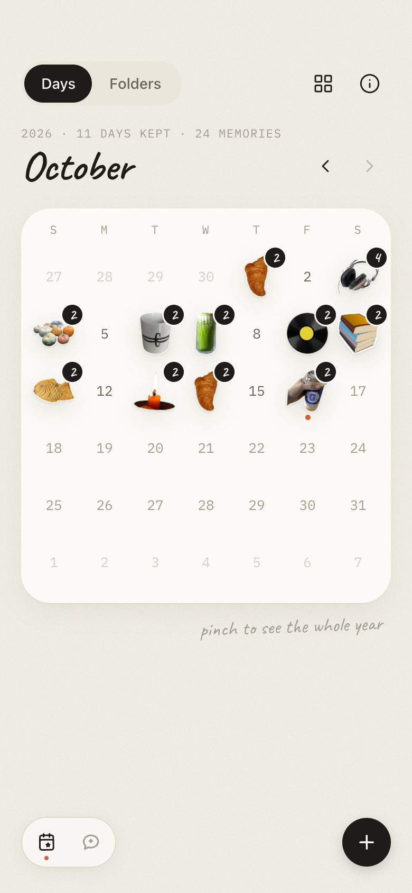
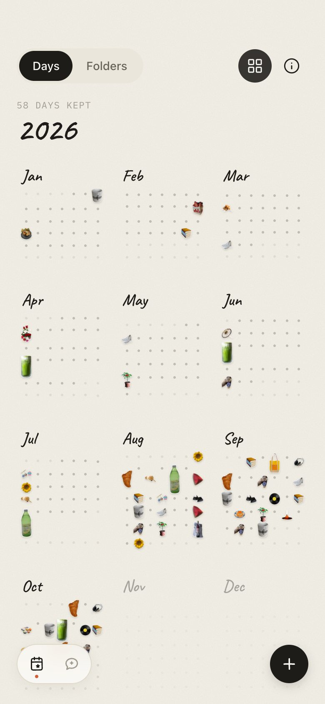
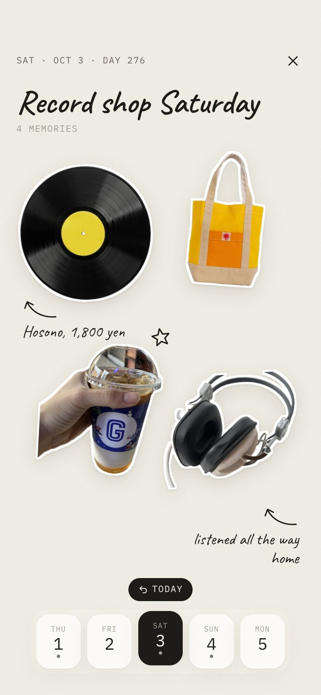
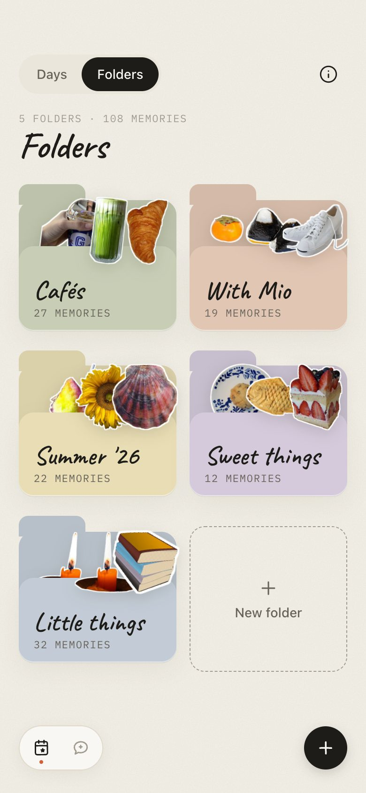

# Hibi

**Hibi** (日々, "days") is a daily photo diary where every day becomes a sticker and every month becomes a page of stickers.

This repository is an **interactive design prototype**, not a production app. It runs entirely in the browser:

- There is no backend, account, or database. Nothing is saved after a reload.
- The camera and chat are simulated.
- All diary content is fictional, set on a fixed demo date of **October 16, 2026**.

<p>
  
  
  
  
</p>

## Features

- **Calendar home**
  - Each day shows a die-cut sticker of its photo, with a handwritten count badge when there are several.
  - Pinch (or ctrl + scroll / trackpad pinch) to zoom out to the whole year. Swipe sideways to change month.
- **Folders**
  - The same home, grouped into paper folders such as *Cafés* or *With Mio*.
  - You can create and delete folders. Deleting a folder keeps its memories.
- **Day collage**
  - Each day opens as a hand-arranged collage, with handwritten notes, ink arrows and small doodles.
  - Tap a sticker to change its folders or delete it.
- **Capture**
  - A simulated viewfinder with an optional note and folders.
  - A photo from your library is read locally and never uploaded.
- **Ask Hibi**
  - Ask about a month, a folder or a friend.
  - Answers are deterministic keyword matches over the sample diary, not a live AI.

## Getting started

Requires Node.js 20 or newer.

```sh
npm ci
npm run dev -- --host 127.0.0.1    # http://127.0.0.1:5173
```

| Command | What it does |
|---|---|
| `npm run dev` | Start the Vite dev server |
| `npm run build` | Type-check with TypeScript, then build to `dist/` |
| `npm run preview` | Serve the built `dist/` |

Pages:

- `/` — the app. On desktop it appears in a phone frame; below 500px it fills the screen.
- `/system.html` — a living reference for the design system.
- `/credits.html` — photo credits.

## Demo walkthrough

1. **Days.** October 2026 opens first.
   - Use the arrows or swipe to move between months.
   - Pinch, or use the grid button, to see the whole year. Tap a month to go back to it.
2. **Folders.** Switch with the *Days / Folders* toggle. Open a folder, or add one with **New folder**.
3. **A day.** Tap a sticker in the calendar to open that day's collage. The date strip at the bottom moves between days.
4. **Capture.** The **+** button opens the camera. Press the shutter, add a note, then **Save to today**.
5. **Ask.** Try *"When did I last see Mio?"* or *"What did I eat in August?"*. Tap a cited sticker to open that day.
6. **Reset.** The ⓘ button explains the demo's limits and offers **Reset the demo**. Reloading resets it too.

## Tech

- React 19 and TypeScript (strict)
- Vite 6, with a multi-page build for the app and the design-system page
- [Motion](https://motion.dev) for springs and shared-layout transitions
- Plain CSS with design tokens (no CSS framework)
- Bundled fonts: Caveat and IBM Plex Mono, both OFL. No runtime network requests.

## Project structure

```
src/
  App.tsx            in-memory state, tab and overlay navigation, phone frame
  screens/           Home (month / year / folders), DayScreen, CaptureScreen, ChatScreen, FolderScreen
  ui/                Sticker, DayCell, Folder, Segmented, BottomNav, Sheet, Button, hand-drawn icons
  data.ts            the fictional diary (Jan–Oct 2026) and date helpers
  calendar.ts        month grid maths (always 6 weeks)
  collage.ts         hand-tuned collage layouts for the day page
  chat.ts            deterministic chat answers
  gestures.ts        pinch, ctrl+wheel and swipe handling
  stickers.ts        sticker artwork registry
  styles/            tokens.css, components.css, app.css
  system/            the design-system reference page
public/
  stickers/          38 die-cut sticker images (WebP)
  fonts/             bundled woff2 fonts and their licenses
  credits.html       photo credits
DESIGN.md            design system spec (source of truth for visuals)
ARTWORK.md           image sources, authors, licenses and processing notes
```

## Design

The visual language is described in [DESIGN.md](DESIGN.md). The concept is "a paper diary on a kitchen table":

- warm paper surfaces with near-black ink
- one persimmon accent, used only for "today"
- handwriting for anything personal, typewriter mono for dates
- photos rendered as die-cut stickers

## Credits and licensing

- **Sticker photos** come from Wikimedia Commons under CC0, public domain, CC BY or CC BY-SA licenses.
  - The backgrounds were removed locally, and the full attribution for each image is in [ARTWORK.md](ARTWORK.md) and `public/credits.html`.
  - The CC BY-SA images remain under CC BY-SA when reused.
- **Fonts** are under the SIL Open Font License. The license files are in `public/fonts/`.
- **Code:** no license has been chosen yet.
